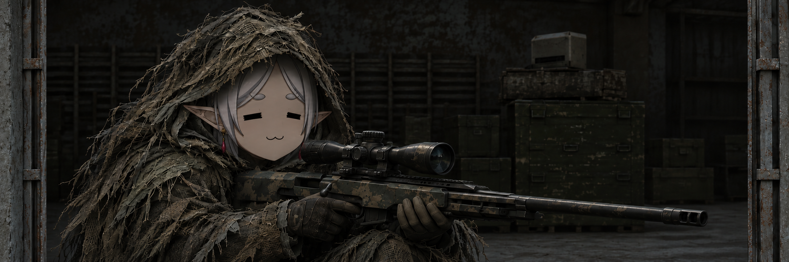
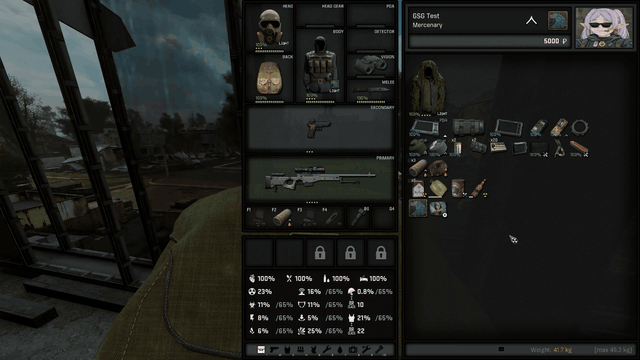

# Ghillie Suits Gud

### Keep your armor. Wear the ghillie.

A wearable camouflage wrap for **S.T.A.L.K.E.R. Anomaly · G.A.M.M.A. 0.9.5**  
Made by **BLUDED**

**5 kg** · **One belt slot** · **Ghillie arms** · **Reversible conversion**

[Installation](#install) · [Features](#what-it-does) · [Compatibility](#requirements) · [Under the hood](#how-it-works) · [Credits](#credits)

---

Want to larp and wear a Ghillie 24/7 without having to take off your better armor?

Well... welcome to **GSG**.

Turn a normal ghillie suit into a belt attachment, wear it over your armor, and get camouflage with matching first-person arms. When you want the full suit back, sew it back together.

<em>Cut the suit into a wrap, then wear it over your armor.</em>

|  Wear it | Make it yours |  Look the part |
| :--- | :--- | :--- |
| Camouflage over supported armor using one belt slot. | Cut a suit into a wrap and sew it back with its condition preserved. | Ghillie first-person arms, including a split sleeve for Wearable Devices. |

## Requirements

**Designed for G.A.M.M.A. 0.9.5.** Nothing outside the standard GAMMA modlist is required.

| Setup | Verification |
| :--- | :--- |
| **REDONE** | Stealth and conversion checked in-game. Damaged-suit condition survives cutting, sewing, saving, and reloading. |
| **Standard GAMMA** | Default calculations pass automated tests. Dedicated in-game verification is pending. |
| **Wearable Devices** | Split sleeves and arm restoration checked in-game. |

This includes demonized's modded exes ([xray-monolith](https://github.com/themrdemonized/xray-monolith)), which GAMMA installs for you. The mod needs them for DLTX, which it uses to add the wrap without overwriting GAMMA's files. Any build since late 2021 works. The arm swap only uses features from the original Anomaly 1.5.2 engine.

GSG also works alongside these beautiful optional add-ons if you have them:
- **REDONE collection**: the mod detects REDONE's foliage detection script and uses tuned defaults for it.
- **[Sloptimizer 9000 for Stalker GAMMA](https://github.com/businessdrewski-hash/sloptimizer-9000-for-Stalker-GAMMA)**: the mod waits for sloptimizer to apply its own patch before installing (see *How it works*).
- **[Wearable Devices](https://github.com/sulikz/st-wearable-devices)**: fully supported, nothing extra to install (see *Ghillie arms*).
- **Other hands packs** such as M.H.P. (Max_im16) or AHMP (Kmack & Maka): the wrap shows that pack's ghillie arms instead of THAP Rework's.

## Install

1. Install the release ZIP through **Mod Organizer 2**.
2. Enable **[BLUD] - Ghillie Suits Gud** near the bottom of the left pane, after the stock GAMMA mods.
3. Launch the game. Open **MCM → Ghillie Suits Gud - GSG** to tune the settings.

For manual installation, copy the mod folder into your GAMMA `mods` directory. Its `gamedata` folder should sit directly inside the mod folder.

> [!NOTE]
> Allow about **six seconds after loading** for GSG's stealth hook to initialize. This gives Sloptimizer time to apply its patch first, that is if you use the mod.

## What it does

- **`ghillie_wrap`**: a belt attachment that weighs 5 kg, gives no protection and has no condition loss.
- **Getting one**: obtain a normal ghillie suit, then right-click a `ghillie_outfit` you're not wearing and choose **Cut into ghillie wrap**. This consumes the outfit and creates one belt attachment. Normal ghillie suit spawning is unchanged. Traders that buy outfits also buy the wrap.
- **Turning it back**: right-click a wrap in your backpack (not on the belt) and choose **Sew back into ghillie suit**. The wrap keeps the suit's condition, so you get back the same condition you cut. Suits with upgrades can't be cut; remove the upgrades first.
- **Stealth**: applies against human NPCs only, over any armor except exoskeletons.

  Default camouflage multipliers at **25 m or farther**, before the separate armor-penalty reduction or interaction with a worn ghillie outfit. Lower means less visual detection contribution. Values are rounded:

  | What you're doing | Standard GAMMA | With REDONE |
  |---|---|---|
  | Standing still | 5% | 5% |
  | Creeping (slow crouch) | 24% | 28% |
  | Crouch-running (fast crouch) | 58% | 60% |
  | Walking | 66% | 68% |
  | Sprinting, jumping, falling, or within 3 s of firing | 100% | 100% |

  NPCs still add up what they see over time, so even standing still in someone's view for long enough will eventually get you noticed.

  - The camouflage fades in between 5 m and 25 m from the NPC.
  - The detection penalty for heavier armor is halved. This fades with the camouflage too, so it does nothing while sprinting, firing or up close.
  - If you also wear `ghillie_outfit` as your armor, only the stronger camouflage counts.
- **Ghillie arms**: while the wrap is on your belt, your first-person arms change to the ghillie suit's arms. Take the wrap off and your armor's own arms come back. If you wear a Wearable Devices bracer, your left arm shows your armor's own sleeve instead, so the ghillie rags don't poke through the device; the right arm stays ghillie.
- **Exoskeletons**: the wrap can't be attached to an exoskeleton. If you try, it goes back into your backpack and a message says so. The same happens if you put an exo on while the wrap is on your belt. Any armor whose section name contains `exo` counts as an exoskeleton, as do the Nosorog suits. To adjust this, edit `[ghillie_gud_force_exo]` and `[ghillie_gud_never_exo]` in `gamedata/configs/mod_system_ghillie_gud.ltx`. Be warned, this mod was NEVER intended to work with exo-suits, that would be TOO op.
- **MCM**: camouflage strengths, movement modifiers, distance fade, armor reduction, and the firing cooldown have sliders under *Ghillie Suits Gud - GSG*. The default strength differs depending on whether GAMMA's own detection script is active or the REDONE foliage version is.

## How it works

<strong>Detection, load timing, and compatibility</strong>

GAMMA decides how fast NPCs spot you in a script called `visual_memory_manager.script`. This mod doesn't replace that script or need any particular version of it. It hooks into whichever copy is active in your setup and makes the result smaller while the wrap is on.

**No specific Atmospherics or stealth mod is required.** Several mods ship their own copy of that script, and MO2 loads the winning copy according to file priority. The integration targets the formulas used by:

- `290- Atmospherics` (stock GAMMA)
- newer Atmospherics releases such as v2.69 (stock 290 can be disabled)
- `45- Stealth Overhaul` or Stealth Overhaul v2.31
- `G.A.M.M.A. Stealth Crash Fix`
- REDONE's Combat AI Foliage Detection

With REDONE's foliage version, the default moving camouflage strength is slightly lower to account for its foliage detection.

The hook goes in about 6 s after a save loads. That delay is only for compatibility with sloptimizer, which is optional. Sloptimizer patches the same function 5 s after loading, but only if it finds the original still in place. Waiting lets it go first. Without sloptimizer, the delay just means the wrap gives no stealth for the first few seconds after a load.

See the header of `gamedata/scripts/ghillie_gud.script` for details. =)

## Troubleshooting

| What you see | What to check |
| :--- | :--- |
| Stealth seems inactive | Wait six seconds after loading. Check the belt, armor, distance, movement, and firing cooldown. |
| No cut action | Take the suit off first. Upgrades must be removed before cutting. |
| No sew action | Move the wrap into your backpack. |
| Wrong arms or unexpected behavior | Enable **Debug log** in MCM, reproduce the issue, then run `flush` in the game console. Include `[ghillie_gud]` log entries and reproduction steps in your report. |

---

## Credits

Ghillie Suits Gud is made by **BLUDED**. It builds on work by these people and mods:

- **Grokitach and the G.A.M.M.A. team**: the modpack, the base ghillie outfit, and the trader and belt systems the wrap plugs into.
- **GSC Game World and the Anomaly team**: S.T.A.L.K.E.R. Anomaly, its engine and the original ghillie suit assets.
- **themrdemonized**: the modded exes ([xray-monolith](https://github.com/themrdemonized/xray-monolith)) and DLTX, which let this mod add content without overwriting other files.
- **Demonized**: Perk-Based Artefacts, whose belt attachment template the wrap is built on.
- **IENCE**: THAP Rework, which provides the first-person ghillie arms in stock G.A.M.M.A.
- **G.A.M.M.A. Icons**: the ghillie outfit icon that the wrap's icon is cropped from.
- **Sulik, Jeremussy and Wiarubane**: [Wearable Devices](https://github.com/sulikz/st-wearable-devices), whose split left-arm approach inspired the clipping fix.
- **xcvb** (Stealth Overhaul), **Hippobot** (Atmospherics) and **eAkman** (REDONE): the stealth and detection scripts this mod hooks into.
- **RavenAscendant**: Mod Configuration Menu (MCM).
- **businessdrewski-hash**: [Sloptimizer 9000 for Stalker GAMMA](https://github.com/businessdrewski-hash/sloptimizer-9000-for-Stalker-GAMMA), performance patches this mod is built to coexist with.

## AI Assistance
Claude Opus 5.5 assisted with writing the test scripts in `tests/` , documentation , and for debugging.
Codex GPT-6 Astra was used to create the banner from an in-game screenshot. 

## Copyright and license

© 2026 BLUDED. All rights reserved.

You may download and use Ghillie Suits Gud for personal, non-commercial play. Redistribution (including in modpacks or re-uploads), derivative works, commercial use and reuse of its code or assets need written permission. The full terms are in [LICENSE](LICENSE).

Ghillie meshes, textures, icon art and the other mods this one works with belong to their creators. See [THIRD_PARTY_NOTICES.md](THIRD_PARTY_NOTICES.md) for what's included, what's only used, and who owns it.

S.T.A.L.K.E.R. is a trademark of GSC Game World. This is a fan-made mod and isn't affiliated with or endorsed by GSC Game World, the Anomaly team or the G.A.M.M.A. team.
